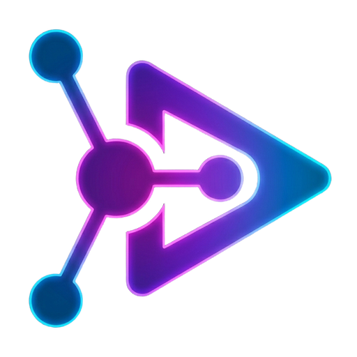
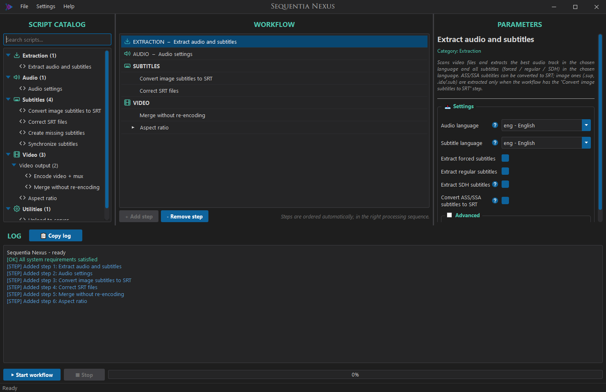
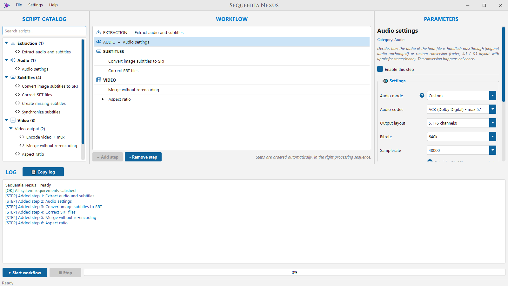
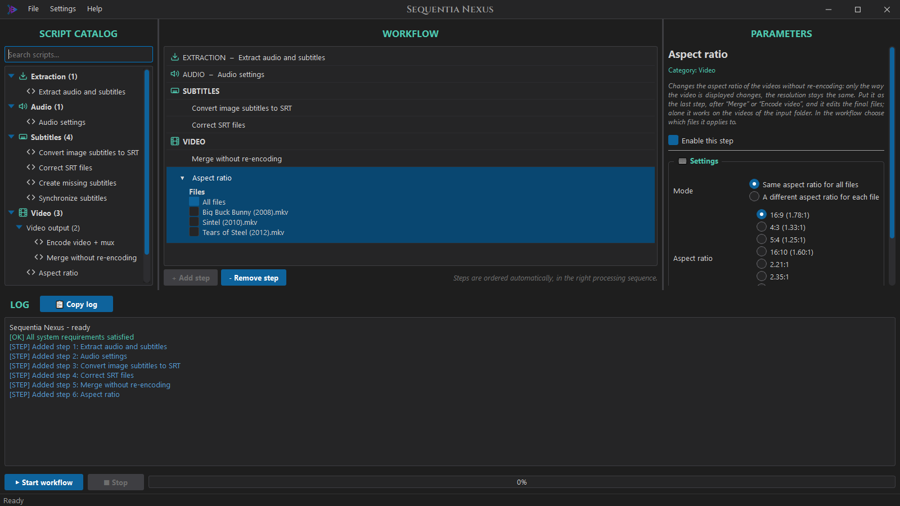
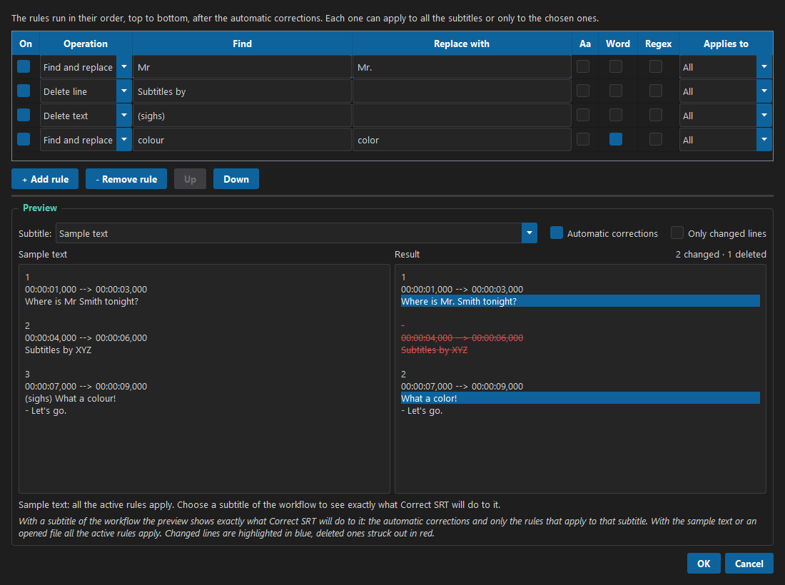
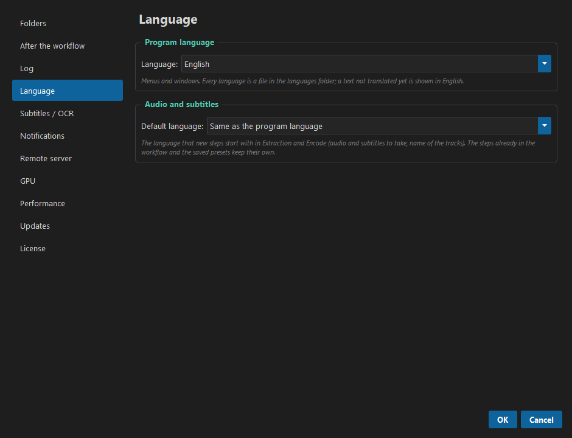
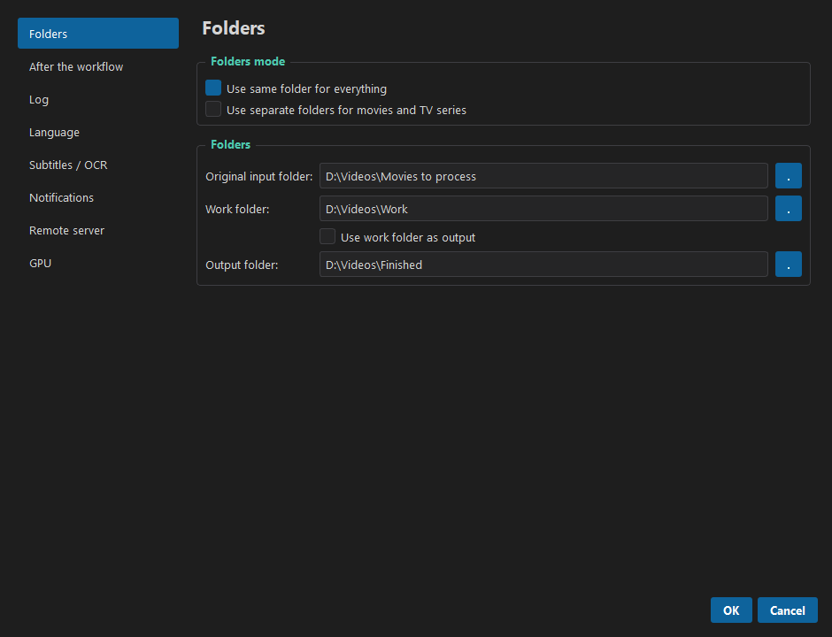
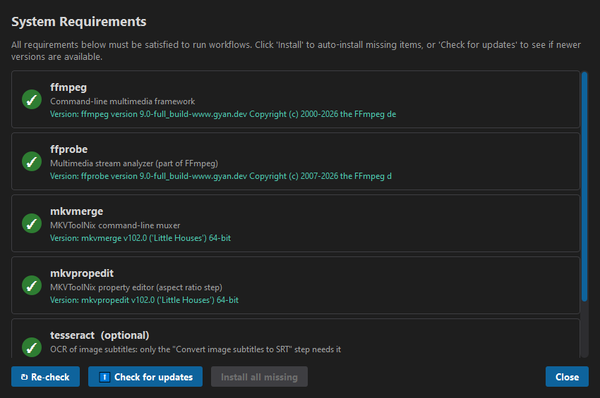

  

<h1 align="center">Sequentia Nexus</h1>

  Build a video processing workflow once, then run it on a whole folder of movies or TV series. 
  Extract, convert, fix subtitles, merge or encode, without typing a single command.

  
  
  

  

---

## What it does

Sequentia Nexus is a desktop app for people who prepare their own video library. You pick the
steps you need from a catalog, set them up once, and the app runs them in the right order on
every video in a folder. The result is a clean MKV with the audio and subtitles you want.

- **Extract** the best audio track and all subtitles in your language, sorted into
  *forced*, *regular* and *SDH*.
- **Convert the audio**: keep it as it is or convert it (AC3, E-AC3, AAC, FLAC, DTS, Opus,
  MP3), with 5.1 / 7.1 upmix and an optional even loudness (EBU R128) for every episode.
  Several files are converted at the same time.
- **Read image subtitles** from Blu-rays (`.sup`) and DVDs (`.idx/.sub`) and turn them into
  SRT text, with a smart correction that fixes the typical OCR mistakes.
- **Fix the subtitles**: clean tags and encoding errors, create a missing *regular* or
  *forced* subtitle, resync the timing, and add your own find-and-replace rules with a live
  preview on the real subtitles of your videos.
- **Merge** everything into an MKV, or **encode** the video (NVIDIA NVENC or CPU,
  H.264 / H.265). With two NVIDIA cards, two videos are encoded at the same time, and the
  CPU converts the audio while the cards encode.
- **Burn subtitles into the video** (hardsub): SRT with a Blu-ray-like style, ASS with its own
  style and fonts, Blu-ray and DVD image subtitles as they are. The fonts of ASS subtitles
  stay in the final file; an episode that lacks one borrows it from the other episodes.
- **Change the aspect ratio** of the final files without re-encoding.
- **Upload the finished files to your NAS** (SFTP, FTPS or FTP), also from outside home,
  into the movies and series folders, with resume if the connection drops: several files at
  once, and each file as soon as it is ready, while the others are still encoding.
- **Movies and TV series** can have separate folders and separate settings: one workflow,
  two passes.
- **Presets**, a check before every run, a live log, a progress bar that moves while
  each file is worked on, a workflow list where every working step shows a turning arrow and
  each finished step a ✓ or ✗ (for movies and TV series separately), an optional notification on screen or on Telegram when the work is
  done, dark and light themes.
- **Eleven languages**: English, Italian, French, German, Spanish, Portuguese (Portugal),
  Portuguese (Brazil), Romanian, Russian, Turkish and Simplified Chinese. Each language is one file in `languages/`, so a new one can be
  added without touching the code.

## Screenshots

<table>
  <tr>
    <td width="50%"> Light theme: audio settings</td>
    <td width="50%"> Choose which files a step applies to</td>
  </tr>
  <tr>
    <td width="50%"> Custom subtitle rules with a live preview</td>
    <td width="50%"> OCR languages, downloaded with one click</td>
  </tr>
  <tr>
    <td width="50%"> Folders: one set for everything, or movies and series apart</td>
    <td width="50%"> Requirements checked and installed for you</td>
  </tr>
</table>

## Requirements

| | |
|---|---|
| **System** | Windows 10 or 11 (macOS and Linux are planned) |
| **FFmpeg** and **MKVToolNix** | Required. Installed from the app (*Settings → System Requirements*) |
| **Tesseract OCR** | Optional: only the image subtitle step needs it |
| **NVIDIA GPU** | Optional: only for NVENC encoding. The CPU encoders work everywhere |
| **License** | Beta testers receive a license key. One license works on one PC, and starting a workflow needs an internet connection |

FFmpeg, MKVToolNix and Tesseract are separate programs with their own licenses: the app
installs them with `winget` and calls them, it does not include them. The other components
inside the program are listed, with their licenses, in `THIRD-PARTY-NOTICES.txt` in the zip.

## Getting started

1. Download `SequentiaNexus-<version>-windows.zip` from the [Releases](../../releases) page and
   unpack it in a folder of your choice.
2. Double-click **`SequentiaNexus.exe`**. The program is not signed yet: if Windows shows
   *Windows protected your PC*, click **More info** → **Run anyway**.
3. The first time, the **System Requirements** window opens by itself: press
   **Install all missing**.
4. Get your free beta key at [sequentianexus.com/beta](https://sequentianexus.com/beta), then
   open **Settings → Preferences → License**, paste it and press **Activate**.
5. Open **Settings → Preferences → Folders** and choose the folder with your videos and the
   folder for the finished files.
6. Double-click the steps you want in the **Script catalog**, set them up in **Parameters**,
   and press **▶ Start workflow**. An internet connection is needed to start a workflow.

During the beta the program is free: get your personal key at
**[sequentianexus.com/beta](https://sequentianexus.com/beta)**.

The full guide is in **[docs/HOW_TO_USE.md](docs/HOW_TO_USE.md)**.

## Feedback

Sequentia Nexus is in beta. Bug reports and ideas are welcome in the
[Issues](../../issues) page. Please add the log of the run (*📋 Copy log*) and say which steps
were in the workflow. Issues are public: before pasting a log, remove what you do not want to
show, such as the address, port and user name of your server (*Upload to server* step).

## License

Copyright © 2026 Seqnex. All rights reserved. The beta is free for invited testers under the
[beta terms](BETA-TERMS.txt); the source code is not public.

Built with Qt for Python (PySide6, LGPL). Uses FFmpeg, MKVToolNix and Tesseract, installed
separately under their own licenses. OCR models: Tesseract `tessdata_best` (Apache 2.0).
Word frequencies: [FrequencyWords](https://github.com/hermitdave/FrequencyWords)
(OpenSubtitles).
