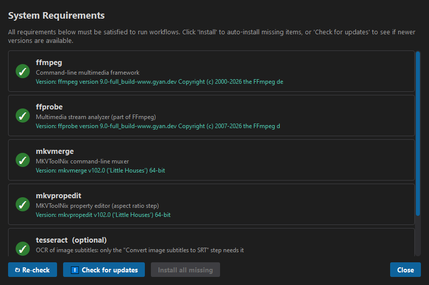
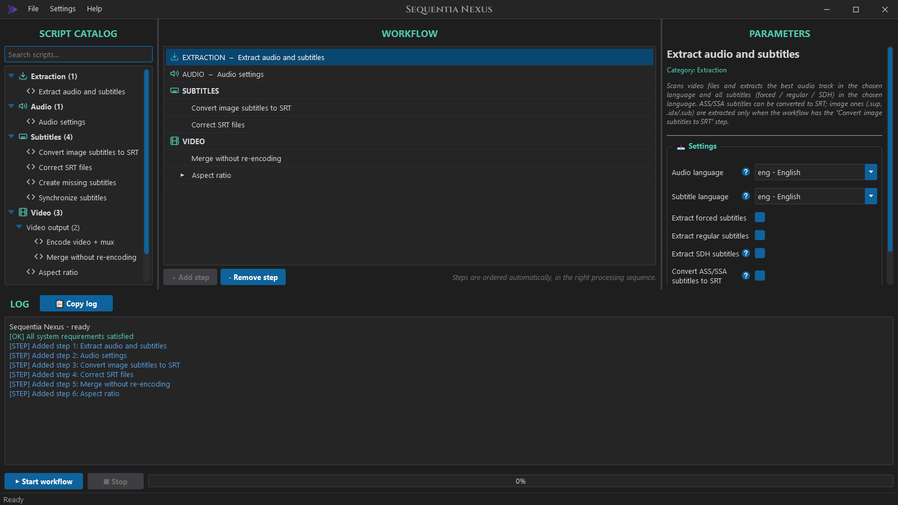
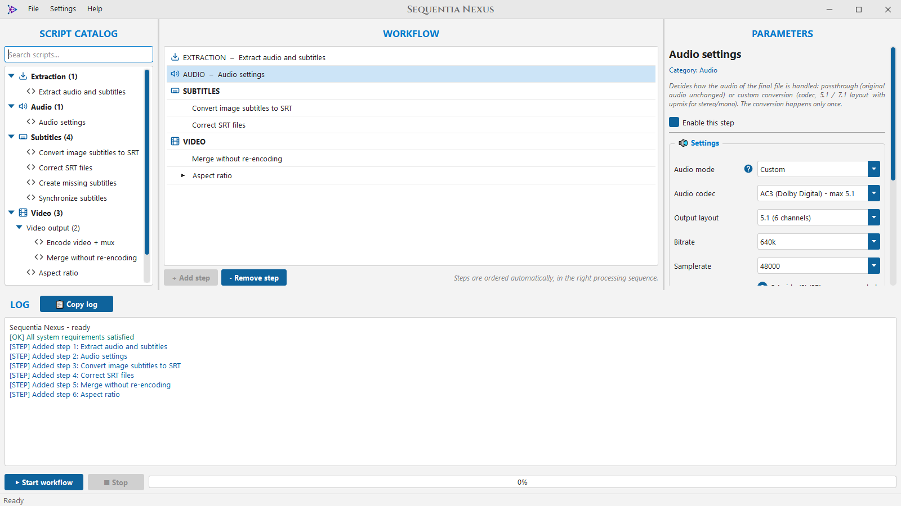
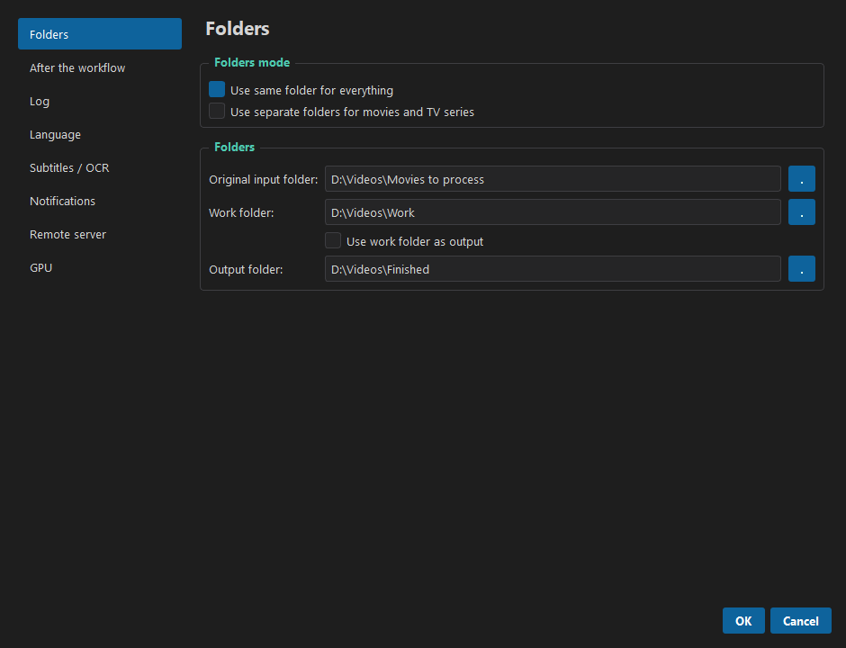
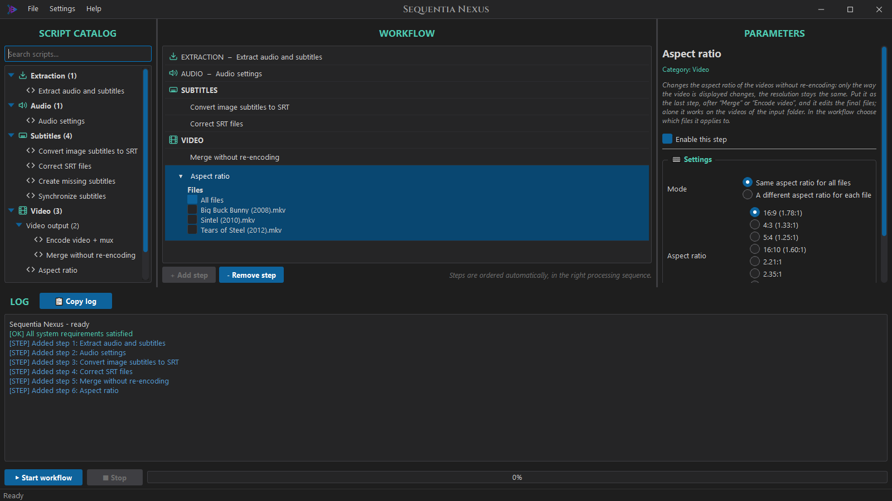
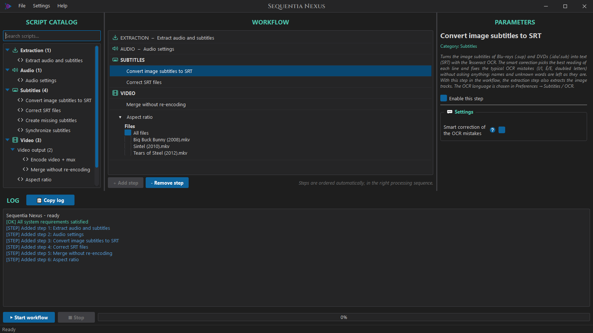
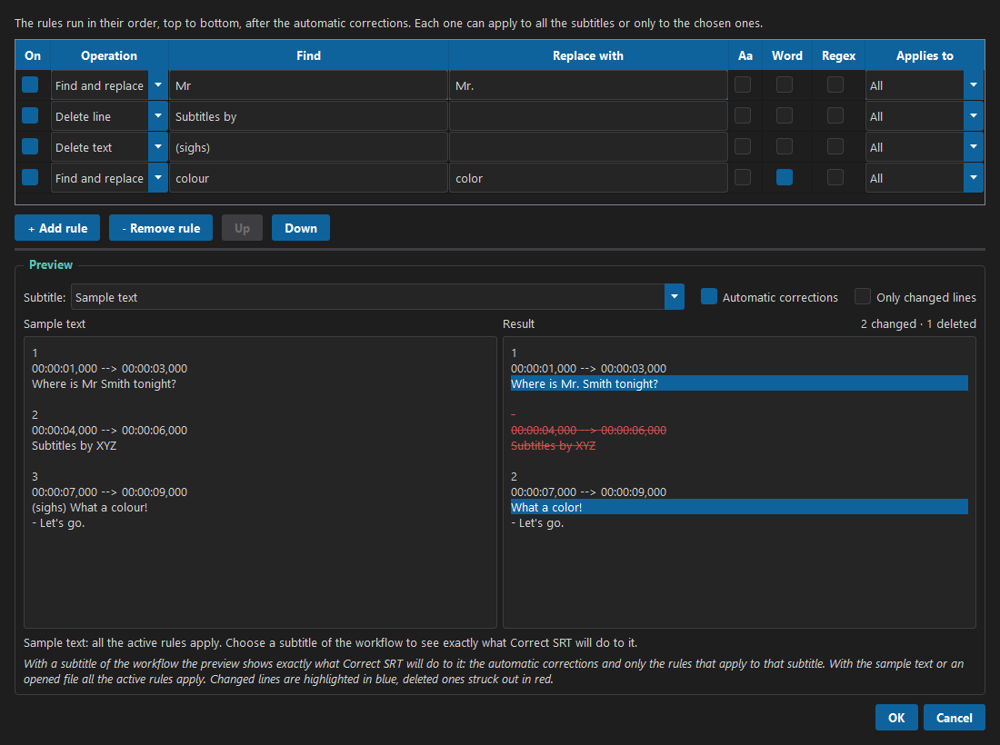
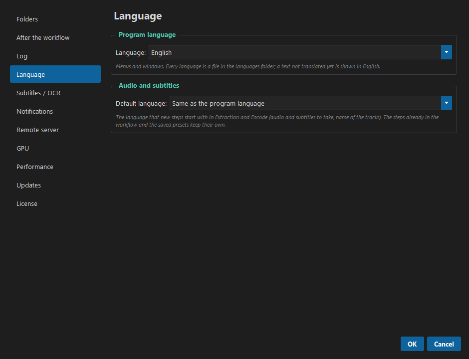
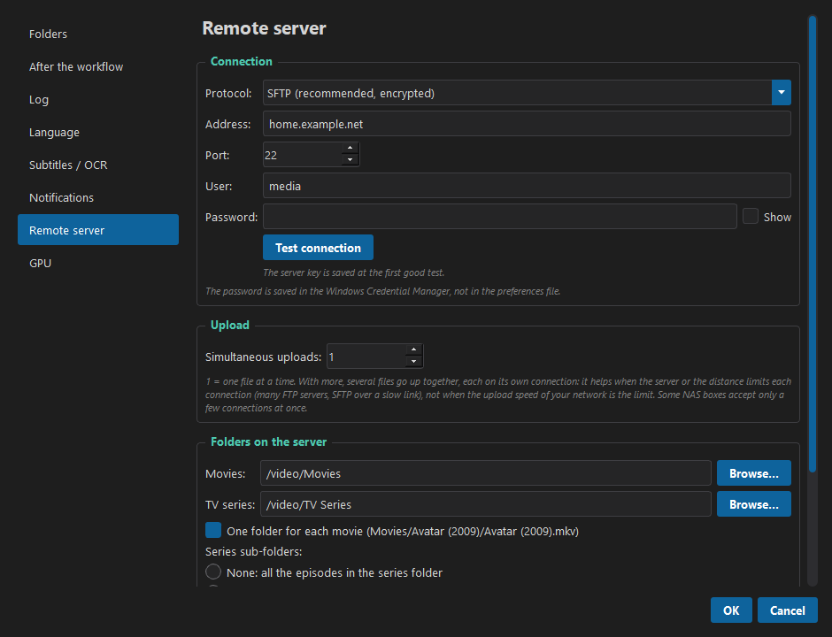

# How to use Sequentia Nexus

This guide covers version **0.37.2**. Sequentia Nexus is in beta: some parts may still change.

**Contents**

1. [Install](#1-install)
2. [The main window](#2-the-main-window)
3. [Set up your folders](#3-set-up-your-folders)
4. [Build a workflow](#4-build-a-workflow)
5. [Run a workflow](#5-run-a-workflow)
6. [The steps](#6-the-steps)
7. [Subtitles in depth](#7-subtitles-in-depth)
8. [Preferences](#8-preferences)
9. [Presets](#9-presets)
10. [Troubleshooting](#10-troubleshooting)
11. [Where your data is stored](#11-where-your-data-is-stored)

---

## 1. Install

### Install the beta (Windows 10 / 11)

1. Download `SequentiaNexus-<version>-windows.zip` from the **Releases** page.
2. Unpack it in a folder of your choice, for example `C:\Sequentia Nexus`. Everything the
   program needs is inside: nothing else to install, except the external programs below.
3. Double-click **`SequentiaNexus.exe`**. The program is not yet signed with a certificate, so
   the first time Windows may show *Windows protected your PC*: click **More info**, then
   **Run anyway**.
4. Get your free beta key at **[sequentianexus.com/beta](https://sequentianexus.com/beta)**
   (one click and a quick "I am not a robot" check), then open **Settings → Preferences →
   License**, paste it and press **Activate** (see [License](#license)).

To update, unpack the new version in place of the old one: your preferences, presets and
license stay where they are (see [Where your data is stored](#11-where-your-data-is-stored)).

### System Requirements window

The app needs some external programs. The first time they are missing, the
**System Requirements** window opens by itself. You can open it at any time from
**Settings → System Requirements...**.



| Program | Needed for |
|---|---|
| **ffmpeg**, **ffprobe** | Reading and converting audio, video and subtitles |
| **mkvmerge** | Merging the final MKV files |
| **mkvpropedit** | The *Aspect ratio* step |
| **tesseract** *(optional)* | Only the *Convert image subtitles to SRT* step |

- A green check means the program is ready.
- **Install** installs a single missing item; **Install all missing** installs all the
  required ones (optional items, shown in grey, are left out).
- **Check for updates** looks for newer versions.
- **↻ Re-check** runs the checks again.

A program installed here is found right away: you don't need to restart the app.

> Workflows cannot start while a required program is missing.

---

## 2. The main window



| Area | What it is |
|---|---|
| **Script catalog** (left) | All the available steps, grouped by section: Extraction, Audio, Subtitles, Video. Type in *Search scripts...* to filter them. |
| **Workflow** (centre) | The steps of your workflow, in the order they will run. |
| **Parameters** (right) | The settings of the step selected in the workflow. |
| **Log** (bottom) | What the app is doing, live. **📋 Copy log** copies it all. |
| **▶ Start workflow / ■ Stop** | Start and stop the run. The bar next to them shows the progress. |

The menus:

- **File**: *New workflow*, *Open preset...*, *Save preset as...*, *Delete preset...*, *Exit*.
- **Settings**: *Preferences...* (also **Ctrl+,**), *System Requirements...*, *Theme* (Dark,
  Light, System). The program starts in English: the language is chosen in
  **Preferences → Language**. That page always says "Language" in English too, so it can be
  found even in a language you cannot read.
- **Help**: *About*.



---

## 3. Set up your folders

Open **Settings → Preferences... → Folders** before the first run.



| Folder | What goes there |
|---|---|
| **Original input folder** | The videos to process (`.mkv`, `.mp4`, `.avi`, `.mov`). |
| **Work folder** | Temporary files while the workflow runs. Leave it empty to use the default folder inside the app (`work`). It is cleaned at the end. |
| **Output folder** | The finished files. Tick *Use work folder as output* to keep them in the work folder instead. |

The input, work and output folders must be different: the app refuses to save folders that
are the same, because files could be lost.

If you never choose a work or output folder, the first time you press **▶ Start workflow** the
app tells you which default folders it will use (inside the program folder) and asks whether
to **Proceed** or **Cancel**, so you can choose other folders first. This question is asked only
once.

### Movies and TV series apart

Choose **Use separate folders for movies and TV series** to give movies and series their own
input, work and output folders. Then:

- the whole workflow runs **twice**: first on the movies, then on the series;
- some steps (for example *Encode video* and *Aspect ratio*) show two boxes in Parameters,
  **🎬 Movies** and **📺 TV Series**, so they can have different settings;
- if one of the two input folders has no videos, that part is skipped and the other one still
  runs.

---

## 4. Build a workflow

1. In the **Script catalog**, open a section and **double-click a step** to add it.
2. Click the step in the **Workflow** list and set it up in **Parameters**. Settings marked
   **Advanced** are for special cases: the default values are fine for most videos. Move the
   mouse over the blue **?** next to a setting to read what it does; the explanation closes
   when you move away.
3. Repeat for every step you need.

**You don't need to think about the order.** Steps are placed automatically in the right
processing sequence: extraction, audio, subtitles, video output, final touches. You can add
them in any order.

- **- Remove step** removes the selected step.
- **Enable this step** (at the top of Parameters) turns a step off without removing it. A step
  that is off is skipped, and the next steps still find the files they expect.
- Some steps work on chosen files only (for example *Aspect ratio* and *Synchronize
  subtitles*). Their row in the workflow opens with **▸**: tick **All files**, or only the
  files you want. With separate movies and series folders you get a *Movies* and a *Series*
  list.



### A typical workflow

| Goal | Steps |
|---|---|
| Keep the video, convert the audio to AC3 5.1, add clean subtitles | Extract audio and subtitles → Audio settings → Correct SRT files → Merge without re-encoding |
| Same, from a Blu-ray with image subtitles | add **Convert image subtitles to SRT** |
| Re-encode the video too | use **Encode video + mux** instead of **Merge without re-encoding** |
| Only get the audio and subtitles out of the videos | Extract audio and subtitles (alone) |
| Fix the aspect ratio of finished files | add **Aspect ratio** at the end, or use it alone |

---

## 5. Run a workflow

Press **▶ Start workflow**. The program first checks your license with the license server
(see [License](#license)): this needs an internet connection. Then the log is cleared and the
app checks everything before it starts:

- **Errors** stop the run, for example a missing program, a missing folder, a step whose input
  no other step produces, or an encode without a bitrate.
- **Warnings** let you choose: **Start** or **Cancel**. For example: some videos have no
  subtitles in the chosen language.

While it runs:

- **Nothing can be changed**: the catalog, the workflow list, the parameters (shown in grey),
  the presets and the Preferences are locked, so it is clear that the run uses the settings it
  started with. The log, the theme, About and **Stop** stay usable.
- The **workflow list follows the run**: no row is highlighted; every step that is working
  right now shows a **blue arrow that turns** on its right, also two at once (for example the
  audio converted during the encode, or the movies uploaded while the TV series are processed).
  The parameters panel keeps the step you had selected, in grey. When a step ends the arrow
  becomes a mark: **✓** (green) done, **✗** (red) failed, **–** skipped (disabled step, or
  nothing to do), **■** stopped.
- **Encode video + mux has two rows**, *Encode video* and *Mux*, because it works file by file:
  it encodes a video, muxes it, then goes on with the next one (with two video cards, one card
  can be muxing while the other is encoding). Each row has its own turning arrow while that
  phase is working on a file, and a counter of the files that finished it, for example
  `SERIES 3/8` and `SERIES 2/8`; between two files a phase waits with its counter in grey. At
  the end both get their mark; if a file fails, the ✗ goes on the phase where it failed. With
  *Merge without re-encoding* there is one row. Next to the mark a word says
  what it refers to: with one folder `✓ FILE` (one video) or `✓ FILES` (more); with separate
  folders for movies and TV series each step has two marks, one for each pass, for example
  `✓ MOVIES   ✗ SERIES` (`MOVIE` with a single movie). The words are counted when the run
  starts; when the movies or the TV series folder is empty, only the other column is shown. The
  marks stay after the run, until you change the workflow or start it again.
- The **progress bar** follows the step that is running, from 0 to 100%, and moves while each
  file is being worked on: the steps report how far the conversion, the encode, the merge or the
  OCR has got. The text inside the bar gives the step and the whole workflow, for example
  `Encode video + mux 45% · total 69%`. When the workflow ends the bar shows the whole (100%). A pass
  with nothing to do (Movies or TV Series with an empty input folder) does not count.
- The **last line of the log** shows the step that is running, with moving dots:
  `Convert audio in progress...`. When the step ends it becomes `✓ Convert audio completed (2 min 30 s)`,
  or `✗ ... failed` if something went wrong. *Encode video + mux* has two lines, one for each
  phase, with the files done: `Encode video in progress... (3/8)` and `Mux in progress... (2/8)`
  (a phase waiting between two files has no moving dots). When the step ends each phase gets its
  own line and its own time, from its first file to its last: `✓ Encode video completed (1 h 05 min)`
  and `✓ Mux completed (58 min)`; if a file fails, the ✗ goes on the phase where it failed.
- If you scroll the log up to read it, it stays where you are; scroll back to the bottom to
  follow it again.

When the workflow ends, the last line of the log sums it up, in bold: how many videos were
processed and how long the whole workflow took, for example
`1 movie and 3 TV episodes processed in 00:25:41` (with a single folder: `3 videos processed
in ...`). If the workflow stopped or ended with errors, the line gives only the total time.

At the end the GUI also checks that **every video has its final file**. A video can be left
without one even when the steps end well: for example its encode failed and the encode went on
with the others, or it has no audio in the chosen language. Then the workflow ends with an
error that lists those videos, the summary says so (`4 TV episodes processed, 2 not completed,
in 00:16:02`), and only the originals of those videos are kept (if *delete the original
files* is on, the others are removed as usual). The finished files are still moved and
uploaded. To redo only the missing ones, set *Existing files behavior* to **Skip** in *Encode
video* and start the workflow again.

**■ Stop** interrupts the current step and deletes the temporary files.

A step you switched off in the workflow is skipped: the next steps use the files of the last
step before it.

### Where the files end up

- With **Merge** or **Encode video**, the finished MKV files go to the **Output folder**.
- Without them (for example only the extraction step), the audio and subtitles go to the
  Output folder, **one folder per video**, named after the video:
  `Output\Big Buck Bunny (2008)\...`. You get the latest version of each file, for example the
  converted audio and the corrected subtitles.
- The work folder is cleaned at the end.

You can also have the original videos deleted after a successful run: see
[After the workflow](#after-the-workflow).

---

## 6. The steps

### Extraction

#### Extract audio and subtitles

Finds the best audio track in the chosen language and all the subtitles in the chosen
language, and sorts the subtitles into three types:

- **forced**: only the on-screen writings and foreign-language lines;
- **regular**: the normal subtitles;
- **SDH**: for the deaf and hard of hearing, with sound descriptions such as `[door slams]`.

| Setting | |
|---|---|
| Audio language, Subtitle language | The languages to extract, for example `eng - English`. |
| Extract forced / regular / SDH subtitles | Which subtitle types you want. The other subtitle steps follow these choices. |
| Convert ASS/SSA subtitles to SRT | On by default: styled subtitles (ASS, SSA, and MP4 / WebVTT text) become plain SRT; italics and bold are kept, colours, position and fonts are lost. Off: ASS and SSA stay as they are, identical to the original, and reach the final file with their style and fonts (see [Fonts of ASS subtitles](#fonts-of-ass-subtitles); MP4 / WebVTT text still becomes SRT). The SRT steps (Correct SRT, Sync subtitles, Create missing subtitles) leave an ASS unchanged, and the rules preview says so. |
| *Advanced*: SDH threshold, Forced: lines per minute | How a subtitle is recognised as SDH or forced when the video does not say it (see below). |

How the type is chosen, in this order:

1. the title or the flag of the track: "forced", or "SDH" / "CC" / "hearing impaired";
2. SDH, when many lines have sound descriptions in brackets (*SDH threshold*, 30 lines);
3. forced, when the video has several subtitle tracks in that language and this one has less
   than a third of the lines of the longest;
4. forced, when it has fewer lines per minute of video than *Forced: lines per minute* (2).
   A full subtitle usually has 8 to 15 lines per minute, a forced one less than 1.

The log shows the type of each track and why, for example `Stream 5: regular (504 lines, 18.1
per minute)`.

**Video formats.** The input folder can hold `.mkv`, `.mp4`, `.avi` and `.mov` files; the
final file is always an `.mkv` (`Film.mp4` becomes `Film.mkv`). Files in other video formats
(`.ts`, `.webm`, `.wmv`...) are skipped, and the check before the start lists them. Two files
with the same name and different extensions (`Film.mp4` and `Film.mkv`) would give the same
final file: the check before the start stops and asks to rename one.

**Tracks without a language.** Many AVI and MP4 files do not say the language of their
tracks. When a video has no track in the chosen language but has tracks without a language:

- one audio track (or one subtitle track) without a language is used, as if it were in the
  chosen language, and the final file marks it with that language. The check before the start
  and the log say so;
- with several tracks without a language, the check before the start asks which audio track to
  use (the one the GUI would pick is already selected) and which subtitles are in your language
  (none is ticked: tick the right ones, or leave them all empty for no subtitles). Each text
  subtitle shows one of its lines, so you can see its language, for example
  `#2 · mov_text — «Why don't you just admit that you're freaked out by my robot hand?»`.

**Audio in another language.** A video may have its audio only in other languages: a film
that was never dubbed in your language, or the right audio tagged with the wrong language by
whoever made the file. When a video has no audio in the chosen language and no audio without
a language, the check before the start lists these videos by name, and the box **Audio in
another language** has a group for each of them. Everything chosen there applies **only to
that video**, not to the rest of the workflow:

| Row | What it does |
|---|---|
| **Process this film** | Off by default: a video left unticked is skipped, as before. |
| **Audio** | Its audio tracks, each with its language, e.g. `#1 · ger · ac3 5.1 · 448 kbps`. |
| **Audio language in the file** | `ger (as in the track)` for a film that is not dubbed, or `eng (workflow language)` to fix a wrong tag. |
| **Subtitle** | **None**, or one of its subtitles (any language, text or image), with a line of it to recognise it. It replaces the subtitles the workflow would take for this video, and it is on by default in the final file. |
| **Subtitle as** | Only with **Encode video + mux** in the workflow: **In the file, can be turned on (soft)** or **Burned into the picture (hard)**. With **Merge without re-encoding** the subtitle always goes in the file. |

What the subtitle steps do with the chosen subtitle:

- in the **workflow language**: it goes through **Correct SRT files**, but **Create missing
  subtitles** does not turn it into a forced one (it stays as it is);
- in **another language**: no step changes it;
- in both cases **Synchronize subtitles** applies to it, with the values of the other subtitles
  of the same video;
- an image subtitle stays an image (no OCR).

Videos with no audio at all are listed by name too, and skipped.

Image subtitles (Blu-ray `.sup`, DVD `.idx/.sub`) are extracted only when the workflow also
has **Convert image subtitles to SRT**.

> AAC audio is saved as `.mka`, not as a raw `.aac`: some AAC 5.1 tracks lose their channel
> layout in a raw file and become silent after merging.

### Audio

#### Audio settings

| Setting | |
|---|---|
| Audio mode | **Passthrough** keeps the original audio. **Custom** converts it. |
| Audio codec | AC3, E-AC3, AAC, MP3, FLAC, DTS, Opus. The maximum number of channels of each codec is in its name. |
| Output layout | 5.1 or 7.1. Stereo and mono tracks are upmixed. |
| Bitrate | Default: the maximum of the codec (AC3 640k, E-AC3 1536k...). |
| Samplerate | Default: 48000 Hz. |
| 5.1 surround layout | *5.1 side* (recommended) or *5.1 rear*. |
| Run volume check on mono files | Measures the peak of mono tracks and lowers the volume when it goes over the threshold (default -2 dB), so the upmixed audio does not distort. |
| No downmix for audio larger than requested layout | Off: a track with more channels than the codec supports is downmixed. On: the workflow stops instead. |
| Even loudness (EBU R128) | Off by default. Brings the average loudness of every file to the same level, measured as TV channels do. See below. |
| Target loudness (LUFS) | Default -23, the standard of European TV. Higher is louder: -16 is typical of YouTube and podcasts. |
| Maximum peak (dBTP) | *Advanced*, default -2. The limit of the peaks after the correction. |
| Parallel conversions | *Advanced*, default 0 = automatic. How many audio files are converted at the same time (see below). |

**Even loudness** is useful for TV series whose episodes are quieter or louder than the others;
films usually do not need it. It works in two passes: first it measures the audio, then it
raises or lowers the volume of the whole file by the same amount, so the dynamics (quiet
dialogue, loud explosions) stay as they are. Only if that would push the peaks over the limit,
a limiter holds back those short peaks. When it is on, the audio is always re-encoded, even if
it is already in the chosen codec, and the conversion takes about twice as long. The log shows
the measure, for example `Loudness: -31.2 LUFS -> -23 LUFS (+8.2 dB)`.

**Parallel conversions.** FFmpeg's audio encoders use a single CPU core, and AAC at a high
bitrate is slow: an episode can take a few minutes. So several files are converted at the
same time, each on its own core: with 3 episodes the step takes about a third of the time, and
the files are exactly the same as one at a time. *0 = automatic* uses half of the CPU threads,
at most 4; *1* converts one file at a time. In the log each line starts with the number of its
file (`[2/3] Conversion -> ...`).

### Subtitles

These steps run in this order: OCR → Create missing → Correct → Synchronize. Each one passes
all the subtitles on to the next step, including the ones it does not change.

#### Convert image subtitles to SRT

Reads Blu-ray (`.sup`) and DVD (`.idx/.sub`) subtitles with the Tesseract OCR and writes them
as SRT text. See [OCR of image subtitles](#ocr-of-image-subtitles).



| Setting | |
|---|---|
| Smart correction of the OCR mistakes | On by default. Picks the best reading of each line and fixes the typical OCR mistakes. |

If a video already has a text subtitle of the same type, the image one is not converted. If
an image cannot be converted, it is kept as it is and the log shows a warning.

The type of an image subtitle is chosen before the OCR, when its text cannot be read yet: an
SDH track without "SDH" in its title looks like a regular one. After the OCR, a "regular"
subtitle with many sound descriptions in brackets (the *SDH threshold* of *Extract audio and
subtitles*) becomes an **SDH**, and *Create missing subtitles* then makes the clean regular
from it. When SDH is not ticked in the extraction, the sound descriptions are removed at once.

#### Create missing subtitles

Creates the subtitle types a video does not have, from the ones it has:

- the **regular** from the **SDH**: without sound descriptions (`[...]`, `(...)`), music notes
  and speaker names (`JOHN:`, `[JOHN]:`, `JOHN (whispering):`);
- the **forced** from the lines written in capitals (on-screen writings) of the regular, or of
  the SDH.

Only the types ticked in the extraction step are created, and a video that already has that
type is left alone. If a video has no on-screen writings, no forced subtitle is created.

| Setting | |
|---|---|
| Create the regular from the SDH / Create the forced | What to create. |
| *Advanced*: Remove song lyrics (♪) | Also removes the song lines. |
| *Advanced*: minimum capital letters per line, % of capital letters | How a line is recognised as an on-screen writing: see below. |

**How the forced subtitle finds the on-screen writings.** A line counts as a writing (a sign, a
caption, a title) when both conditions are true:

1. it has at least **5 capital letters** (*minimum capital letters per line*): short lines such
   as `NO!` or `OK` do not count;
2. at least **80% of its letters are capitals** (*% of capital letters*): the line is written
   in capitals, not a normal line that happens to contain several names or acronyms.

| Line | Capitals | Share | Forced? |
|---|---|---|---|
| `NO SMOKING` | 9 | 100% | yes |
| `NEW YORK, 1985` | 7 | 100% | yes |
| `NO!` | 2 | 100% | no: fewer than 5 capitals |
| `Where are Mario, Luke, Anna and Paul?` | 5 | 18% | no: a normal line with names |
| `The FBI called the CIA.` | 7 | 39% | no: a normal line with acronyms |

80% (the default) accepts a stray lower-case letter, for example an OCR mistake or
`McDONALD'S`. Set **100%** to keep only the lines written entirely in capitals, or lower it
(down to 50%) if some signs written partly in lower case are missed. Accented capitals (`È`,
`À`) count as capitals. From a subtitle line with a writing and some dialogue, only the
writing is kept; lines without letters, such as `1985`, stay too.

#### Correct SRT files

Cleans the subtitles automatically: HTML and ASS tags, apostrophes used as accents (`e'` → `è`,
`perchè` → `perché`), encoding errors (`è` → `è`), credits at the end, common Italian typos.

Tick **Custom rules** and press **Edit rules...** to add your own: see
[Custom rules](#custom-rules).

#### Synchronize subtitles

Fixes subtitles that are out of sync. In the workflow row choose which subtitles it applies
to.

| Setting | |
|---|---|
| Mode | The same correction for all the subtitles, or one per subtitle. |
| Convert the frame rate | For subtitles made for another edition, for example a 25 fps DVD on a 23.976 fps video: they drift further out of sync as the film goes on. The frame rate of the video is read automatically. |
| Shift the times | Moves everything later (positive) or earlier (negative), in milliseconds: 1000 ms = 1 second. |

### Video

**Merge without re-encoding** and **Encode video + mux** are in the *Video output* group: a
workflow has one or the other. Both make the final MKV: *Encode video + mux* encodes the video
and then does the mux itself, so it needs no *Merge* after it. Clicking one of them in the
catalog when the other is already in the workflow replaces it, and the log says so.

#### Merge without re-encoding

Puts the original video, the audio of the audio step and the subtitles into a new MKV, without
re-encoding. The tracks get clear names, such as `Eng AC3 5.1` and `English forced`. If a type
has both a text and an image subtitle, the text one is used. The attachments of the original
(the fonts of its ASS subtitles, a cover) stay in the new file; for fonts the video lacks see
[Fonts of ASS subtitles](#fonts-of-ass-subtitles).

| Setting | |
|---|---|
| Keep chapters from original | Off by default. Copies the chapters of the original video (e.g. opening, episode, ending). |
| Keep global/track tags | Copies the tags. |

#### Encode video + mux

Encodes the video, then merges it with the audio and subtitles like *Merge* does. The audio is
not converted again.

| Setting | |
|---|---|
| Video codec | H.264 or H.265, on an NVIDIA GPU (**NVENC**, fast) or on the CPU (x264 / x265). The NVENC codecs are listed only if a card passed the NVENC test (see [GPU](#gpu)). |
| Video bitrate | **Required**: there is no default, you have to enter it (for example `4000` = 4000 kbit/s). Not needed with NVENC in *VBR constant quality (CQ)*. |
| Not above the original bitrate | Off by default. When the original video has a lower bitrate than the chosen one, the encode uses the original one: a video downloaded from the web at 1100 kbit/s encoded at 2600k only becomes twice as big, with no gain in quality. The log says which bitrate is used, for example `Original video at 1135 kbit/s, below 2600k: 1135k is used`. With an H.265 original the same bitrate in H.264 is a little less sharp. Not used with CQ. |
| NVENC preset / CPU preset | Speed against quality. |
| Bit depth | 8 or 10 bit. |
| Include forced / regular / SDH subtitles | Which subtitles go into the final file (hidden with the hardsub). |
| Burn subtitles into the video (hardsub) | Off by default. See [Hardsub](#hardsub) below. |
| Subtitle to burn | Forced, regular or SDH: only the types enabled in *Extract audio and subtitles*. |
| Existing files behavior | Overwrite, skip, or stop with an error when the final file already exists. |
| Keep chapters from original | Off by default. Copies the chapters of the original video (e.g. opening, episode, ending), as in *Merge*. |
| *Advanced* | Rate control, CQ values, AQ, lookahead, multipass, frame rate; the style of a burned SRT (font, size, colour, black outline). |

Which card does the encode, or whether two cards encode two videos at the same time, is chosen
in **Preferences → GPU**. There you also find two options, on by default, that make the
workflow faster: the card also decodes the video, and *Convert audio* works while the cards
encode (see [GPU](#gpu)).

A source in 10 bit encoded with H.264 is turned into 8 bit (NVENC H.264 has no 10 bit).

If the output folder cannot be written when a video is merged (a USB disk or a network drive
that disconnects for a moment), the encoded video is kept and the merge is tried again after
5, 15, 30, 60 and 120 seconds; the log says `The output folder cannot be written (disk
disconnected?): trying again in 15 s`. The same happens when *Merge* moves the final files.

The attachments of the original (fonts, cover) are kept in the final file, as with *Merge*.

##### Hardsub

With **Burn subtitles into the video (hardsub)** one subtitle type is drawn into the picture.
It shows on every player, also a TV or a phone that cannot read subtitles, but it can no
longer be turned off. Only that type is used: the other subtitles are not put in the file,
because a burned subtitle and others that can be turned on would overlap.

- **SRT**: drawn with the style of the *Advanced* settings. The default looks like a Blu-ray:
  Arial, size 20, white, a thin black outline (1.5) and a light shadow; *italic* and **bold**
  of the subtitle are kept. The size is the same at every resolution.
- **ASS / SSA**: drawn with their own style, position and fonts (to keep an ASS, turn off
  *Convert ASS/SSA subtitles to SRT* in the extraction step). See
  [Fonts of ASS subtitles](#fonts-of-ass-subtitles).
- **Image subtitles** (Blu-ray `.sup`, DVD `.idx` + `.sub`): drawn as they are, no OCR needed:
  with the hardsub the extraction step takes the image tracks even without the OCR step. A DVD
  subtitle is stretched to the video (also an upscaled one); a Blu-ray subtitle made for
  1920x1080 on a cropped video (1920x816) is shrunk to fit, never squashed.

A video that does not have the chosen type (you chose *forced*, but one episode has none) is
encoded without burned subtitles, and the end of the log says so, just before the summary:

```
⚠ 1 video without burned subtitles (no forced subtitle): Show S01E03
4 TV episodes processed in 00:12:40
```

If the type is turned off in the extraction step (for example by an old preset), the
pre-flight check stops the start.

##### Fonts of ASS subtitles

An ASS names its fonts, and an MKV usually carries them as attachments. They are used for the
hardsub and stay in the final file (with *Merge* and *Encode*), so the ASS looks right on every
player. When a video lacks a font its ASS needs:

1. if another video of the same workflow has it (an episode of a series often lacks the font
   the other episodes carry), that one is used and attached to this video too:
   `Font 'Snxtest' not attached to this video: taken from Show S01E01.mkv`;
2. otherwise a font installed on the PC with that name is used;
3. otherwise the text is shown with a similar font, and the end of the log says so:
   `⚠ Font "Nowherefont" found in no video and not installed, shown with a similar font: Show S01E03`.

#### Aspect ratio

Changes how the video is displayed (16:9, 4:3, 2.35:1, custom...) **without re-encoding**: the
resolution does not change. MKV files are changed in a moment.

- At the end of a workflow with *Merge* or *Encode video*, it changes the finished files.
- Alone, it makes changed copies of the videos in the input folder; the originals are not
  touched.
- **Same aspect ratio for all files**, or **A different aspect ratio for each file**, with a
  list of the files chosen in the workflow row.

### Utilities

#### Upload to server

Uploads the finished files to a remote server, for example your NAS at home, also while you
work away from home on a laptop. The server and the folders on it are set once in
[Preferences → Remote server](#remote-server); the step only has the options of this workflow.
Put it in the presets where you need it.

It runs last, after the final files have been moved to the output folder, or together with
the encode if *Upload each file as soon as it is ready* is on in
[Preferences → Remote server](#remote-server). Then:

- each movie goes to the movies folder on the server and each episode to the series folder
  (with movies and series apart, from their own pass; with a single folder, an `S01E01` or
  `1x01` in the name means an episode);
- every file is uploaded as `name.mkv.part` and renamed only when it is complete, so a media
  server (Plex, Jellyfin...) never sees half a film;
- if the connection drops, the upload is tried again and goes on from where it stopped. A
  `.part` left by a stopped workflow is resumed the next time;
- at the end the size on the server is checked.

If a file cannot be uploaded, the workflow ends with errors and the original videos are
**not** deleted, even if *Delete the original videos* is on.

| Setting | |
|---|---|
| If the file is already on the server | **Replace** (the old file is replaced only when the new one is complete) or **Skip**. |
| Delete the local files after the upload | Off by default. After a good upload the final file is deleted from this PC, handy on a laptop. A file that was not uploaded is never deleted. |
| *Attempts if the connection drops* | *Advanced*, default 5, waiting longer each time (5 s, 15 s, 30 s, 1 min, 2 min). |

The time an upload takes depends on the upload speed of the network you are on: on a mobile
connection or a hotel Wi-Fi a 5 GB film can take more than an hour. The log shows the speed of
every file.

**Movies and TV series on different disks.** With movies and TV series apart, the movies are
processed first. If the movie output folder is on a physical disk different from the ones the
TV series use (their input, work and output folders), the movies are uploaded in the background
while the TV series are processed: reading one disk and writing another do not slow each other
down. This happens by itself, there is nothing to set. Two partitions of the same disk count as
the same disk, and so do network folders: then the upload works as before, one part after the
other. In the log the lines of that upload start with `[Upload Movies]`. The TV series upload
waits for the movies one to end (the server gets no more connections than set), the original
movies are deleted only after their upload went well, and the summary arrives when everything,
uploads included, is over.

---

## 7. Subtitles in depth

### Subtitle file names

Inside a workflow the subtitles are named `<video>_sub_<type>.<extension>`, for example
`Sintel (2010)_sub_forced.srt`. In the final MKV each type becomes its own track, with the
*forced* flag on the forced one.

### Custom rules

**Correct SRT files → Custom rules → Edit rules...** opens the rules window.



Every rule is one row:

| Column | |
|---|---|
| **On** | Turns the rule on or off. |
| **Operation** | **Find and replace**, **Delete text** (removes only the text found), **Delete line** (removes the whole subtitle line, times included). |
| **Find** / **Replace with** | The text. |
| **Aa** | Match case. Without it, the replacement follows the case of the text found: `Perchè` → `Perché`, `PERCHÈ` → `PERCHÉ`. |
| **Word** | Whole words only: `sig` does not match `signal`. |
| **Regex** | Regular expression, for expert users. `\1`, `\2` in the replacement are the groups. |
| **Applies to** | **All** the subtitles, or only the ones you tick in the list (`=== MOVIES ===` / `=== TV SERIES ===`). |

The rules run from top to bottom, after the automatic corrections. Use **Up** and **Down** to
change their order. The window can be maximised; drag the bar between the table and the
preview to resize them.

#### Preview

The preview shows the result live: changed lines in **blue**, deleted ones **struck out in
red**, and a count such as *2 changed · 1 deleted*.

In **Subtitle:** choose what to test the rules on:

- **Sample text**: an example you can edit. All the active rules apply.
- **A subtitle of the workflow**: the app takes it from the video, exactly as the extraction
  step will, or creates it as *Create missing subtitles* will. The preview then shows
  **exactly** what *Correct SRT files* will do to it: the automatic corrections (tick
  *Automatic corrections*) and only the rules that apply to that subtitle. It takes a few
  seconds for a big file; videos with only image subtitles are read with the OCR (about a
  minute).
- **Open file...**: any SRT file on your disk.

Tick **Only changed lines** to see just what changes.

### OCR of image subtitles

Blu-rays and DVDs often have subtitles stored as pictures. The step
**Convert image subtitles to SRT** reads them and turns them into text.

**Before the first use:**

1. Install **Tesseract** from **Settings → System Requirements**.
2. Open **Settings → Preferences → Subtitles / OCR** and download the language of your
   subtitles (**Download**: a few seconds).



**How accurate it is.** Every line is read twice, as a whole and line by line, and the smart
correction keeps the reading with the most real words. It then fixes the typical OCR
mistakes, such as `I` / `l` / `1`, `rn` / `m`, missing accents, and in Italian `Io` / `lo`,
`Il` / `II`, `È` / `E`, but only when the result is a real word or a name used in the same
subtitle. Names and words it does not know are left as they are, and it never asks questions.
Typos that were already in the original subtitle are kept.

On the test files: a DVD 40 lines out of 40, an English Blu-ray 29 out of 30, a TV series about
99.5%. Italic text is the hardest part: a quick look at the result is always a good idea.

**Speed.** The OCR uses one CPU core per process. In **Preferences → Subtitles / OCR → Speed**
choose how many processes run together: *Automatic* uses all the cores but one, at most 8. If
you are encoding at the same time, choose a low number, for example 2.

---

## 8. Preferences

**Settings → Preferences...** has one page per topic, listed on the left.

### Folders

See [Set up your folders](#3-set-up-your-folders).

### After the workflow

When a workflow finishes, the original videos can be:

- deleted permanently, or
- moved to the Recycle Bin.

Only the videos processed in that run are removed, and only if their finished file exists
(or was uploaded to the server and then deleted from this PC by *Upload to server*). If some
videos fail, only their originals are kept and the others are removed. Nothing is removed if
the workflow is stopped or has other errors (for example a failed upload).

### Language

- **Program language**: the language of menus and windows: English, Italiano, Français,
  Deutsch, Español, Português (Portugal), Português (Brasil), Română, Русский, Türkçe, 简体中文. Each language is a file in the
  `languages` folder of the program; a text that is not translated yet is shown in English.
  The translations other than English and Italian are new: if you find a mistake, please open
  an issue. At the very first start the program uses the language of Windows, when it is one
  of these (otherwise English); after that, the language chosen here.
- **Audio and subtitles → Default language**: the language that new steps start with in
  *Extract audio and subtitles* and *Encode video* (which audio and subtitles to take, and the
  language written on the tracks of the final file). *Same as the program language* is the
  default: with the program in English new steps start with `eng`. The steps already in the
  workflow and the saved presets keep their own language. Languages with two codes (for
  example German `ger` / `deu`, French `fre` / `fra`) are recognised with either.

### Log

- **Save the log of every workflow to a file**: off by default. The log is saved also when the
  workflow fails or is stopped.
- **Maximum number of saved logs** (1–500, default 30): when it is reached, every new log
  deletes the oldest one.
- **Open logs folder** opens the folder of the saved logs.

### Subtitles / OCR

| Setting | |
|---|---|
| OCR language | *Same as the subtitles of the extraction step* (default), or a fixed language. **Download** / **Remove** manage the languages on your PC. |
| Tesseract | Where Tesseract was found. Leave *Path* empty unless you installed it in an unusual place. |
| Parallel OCR processes | See [Speed](#ocr-of-image-subtitles). |

### Notifications

Both are off by default.

- **Show a notification when a workflow ends**: a message in the corner of the screen (Windows
  notifications) says whether the workflow was completed, finished with errors or was stopped,
  with the preset and how long it took. If the window is not in front, its button on the
  taskbar also flashes.
- **Send a Telegram message when a workflow ends**: the same message on your phone, handy for
  long encodes. To set it up:
  1. In Telegram, open **@BotFather**, send `/newbot` and follow the steps: at the end you get
     the **token** of your bot.
  2. Open your new bot and send it any message.
  3. Paste the token in **Bot token** and press **Find chat ID**.
  4. Press **Send a test message** to check.

  The token is saved only on your computer, in the preferences. If a message cannot be sent
  (no internet, wrong token), the log says so; the workflow is not affected.

### Remote server



The server used by the **Upload to server** step.

**Connection**

- **Protocol**: **SFTP** (recommended: encrypted, offered by almost every NAS), **FTPS**
  (encrypted FTP) or **FTP** (not encrypted: the password and the files travel in clear, so use
  it only at home or through a VPN).
- **Address** and **Port** in two fields: the IP address or name of your home connection (for
  example a dynamic DNS name such as `home.ddns.net`), and the port opened on the router for
  the NAS. The port changes to the usual one (22 or 21) when you change the protocol.
- **User** and **Password** of the NAS. The password is saved in the **Windows Credential
  Manager**, not in the preferences file.
- **Test connection** connects and shows the home folder on the server. With SFTP the first
  good test also saves the **server key**, which is checked at every later connection: if
  another computer answered at that address, nothing would be sent. After a reset of the NAS
  the key changes, and the app asks whether to accept the new one.

To reach the NAS from outside, its port has to be opened on the home router (with a dynamic
DNS name if your home IP address changes), or you can connect through a VPN (Tailscale,
WireGuard, the one of the router or of the NAS). A VPN is safer: nothing is exposed to the
internet.

**Upload**

- **Simultaneous uploads** (1 to 5, default 1): how many files go up at the same time, each on
  its own connection. It helps when each connection is limited by the server (many FTP servers
  do it) or by the distance (SFTP over a slow link); it does not help when the limit is the
  upload speed of the network you are on, because the files then share it. Some NAS boxes
  accept only a few connections at once: when the server refuses one, the log says so and
  that file tries again as soon as another one is finished.
- **Upload each file as soon as it is ready** (off by default): the upload starts together with
  *Encode video + mux* (or *Merge without re-encoding*): each file goes up as soon as it is
  finished, while the others are still being encoded. With a series, when the last episode is
  ready the first ones are already on the server. The original videos are still deleted only
  at the end, if everything went well. With *Aspect ratio* in the workflow the files are
  changed after the encode, so they are uploaded at the end. In the log the lines of the
  upload start with `[Upload]`. Under the box the page checks the disks of your work and
  output folders: on SSD / NVMe it is recommended; on a mechanical, USB or network disk it is
  not, because writing one file while another is read for the upload can be too much for an
  older disk.

**Folders on the server**

- **Movies** and **TV series**: the destination folders. Type them, or press **Browse...** to
  choose them on the server (press *Test connection* first).
- **One folder for each movie**: `Movies/Avatar (2009)/Avatar (2009).mkv`, as Plex and
  Jellyfin like it.
- **Series sub-folders**: none (all the episodes in the series folder), one folder for each
  series (`Tulsa King/`), or series and season (`Tulsa King/Season 04/`). The season folder
  can be called `Season 04`, `Stagione 04` or `S04`. The series name and the season are taken
  from the file name, and the folders that are missing are created on the server.

An example under the options shows where a movie and an episode will go.

### GPU

At the first start the app detects the NVIDIA video cards and tests NVENC on each of them
(H.264 and H.265, about one second). The result is saved, so later starts only count the cards;
if the number changes (a card added or removed), the app asks whether to detect them again.
**Detect again** does it at any time, for example after a driver update.

The page lists the cards with the result of the test, and offers only what they allow:

| Cards found | Choices |
|---|---|
| None with NVENC | Nothing to choose: *Encode video* uses the CPU (x264 / x265), and its NVENC codecs are hidden. |
| One | Nothing to choose: that card is used. |
| Two or more | **GPU 1 only**, **GPU 2 only**... or **All in parallel: one video per card**. |

**In parallel**, each card encodes a different video at the same time, and takes the next one
as soon as it is free: with a series the encode takes about half the time. The log shows which
card each line belongs to (`[GPU 2] Processing: ...`) and the bar adds up the progress of both.
The other steps still work one file at a time (except *Convert audio*, which converts up to
four files at once), because they mostly copy data and would only slow each other down on the
same disk. The disk is not a bottleneck for an encode: even two encodes read only a few MB per
second.

**Speed** (both on by default, with the NVENC codecs):

- **Decode the video with the card.** The card that encodes also reads (decodes) the original
  video, instead of the CPU. The encode is as fast and the frames are the same (checked on
  H.264, H.265 10 bit, VP9; DVD MPEG-2 differs by invisible rounding), but the CPU stays free:
  in the tests, two encodes went from 71% to 35% of the CPU. A video the card cannot decode is
  encoded again with the CPU, and the log says so.
- **Convert the audio during the encode.** The cards cannot encode audio: every audio encoder
  runs on the CPU. Without this option the CPU converts all the audio first, while the cards
  wait, and then the cards encode while the CPU has little to do. With it, *Convert audio*
  starts in the background and the next steps go on: while the cards encode the videos, the
  CPU converts the audio. Each video waits for its own audio only before the final merge (the
  log says `Waiting for the audio conversion of this file...` when it has to). The lines of the
  audio start with `[Audio]`. In the tests (4 episodes of 10 minutes, AAC 512k 5.1, H.264 NVENC
  p7 on two cards) the workflow went from 3 min 50 s to 2 min 53 s; the longer the encode, the
  more of the audio time is saved. If the audio stops with a blocking error, the encode is
  stopped too.

**Disks.** Before every run the app checks the kind of disk of the work folder. If it is a USB
disk, a mechanical disk or a network folder, a note in the log says that the steps that copy
files (extraction, merge) will be slower. It is only a note: nothing is blocked.

### License

During the beta the license key (`SNX-XXXXX-XXXXX-XXXXX-XXXXX`) is free: get it at
[sequentianexus.com/beta](https://sequentianexus.com/beta) (the page *Preferences → License*
has the link too), paste it in **Preferences → License** and press **Activate**.

- The page gives one key a day and a few keys in all to each connection, and a limited number
  of keys a day in all: when today's keys are finished, it asks to come back tomorrow.
- Abuse of the page (many requests in a short time) bans the connection for life and revokes
  every key it received.

- **One license, one PC.** If the license is already active on another PC, the app asks
  first: if you confirm, it moves to this PC and the other PC can no longer use it. To change
  PC, just activate the license on the new one (or press **Deactivate on this PC** on the old
  one first).
- **Internet is needed to start a workflow.** The steps are not inside the program: they come
  from the license server, encrypted for your license, and the key to open them is given at
  every start. They are downloaded once per version and kept in a cache. A workflow that is
  already running always finishes, even if the connection drops.
- Only a code calculated from your PC is sent to the server, never names, files or other data
  of the PC.
- Keep the PC date and time correct: the reply of the license server is checked, and a wrong
  date can make the check fail.

---

## 9. Presets

A preset saves the whole workflow: the steps, their settings, and whether each one is on or
off.

- **File → Save preset as...** saves it with a name.
- **File → Open preset...** loads it.
- **File → Delete preset...** removes it.
- **File → New workflow** starts from an empty workflow.

The files chosen in a workflow row (for example for *Aspect ratio*) are not saved in the
preset, because they change from one folder to the next.

---

## 10. Troubleshooting

| Problem | What to do |
|---|---|
| *The license server cannot be reached* | Check the internet connection: it is needed to start a workflow. |
| *Too many requests to the license server* | Wait a few seconds and press **Start workflow** again. |
| *This license has been activated on another PC* | The license was moved to another PC. To use it here, activate it again in **Preferences → License** (the other PC loses it). |
| *Start workflow* shows errors | Read the list: each error says what to fix. Missing programs are installed from **Settings → System Requirements**. |
| The folder window takes a few seconds to open the first time | That is Windows loading it. The mouse pointer shows that it is busy, and the window comes to the front when it is ready. |
| The final file has no subtitles | Check the log: the video may have no subtitles in the chosen language, or only image subtitles without the OCR step in the workflow. |
| *OCR step: the language is not downloaded* | **Preferences → Subtitles / OCR**, choose the language, **Download**. |
| The OCR slows down an encode | Lower **Parallel OCR processes** to 2. |
| *Encode video: no video card can use H.264 NVENC* | The card was not found or failed the NVENC test: update the NVIDIA driver and press **Preferences → GPU → Detect again**, or choose x264 / x265. |
| *Upload to server: press Test connection* | With SFTP the server key is saved at the first connection: open **Preferences → Remote server** and press **Test connection**. |
| The upload says the server does not answer | Check address and port, and that the NAS can be reached from outside (port open on the router, or the VPN connected). |
| *No audio track found for languages ['eng']* | The video has no audio in the chosen language, and no audio without a language: check its tracks, or choose its language in *Extract audio and subtitles*. If its audio is only in another language, tick *Process this film* in the box *Audio in another language* before the start. |
| *video(s) not completed* at the end of the workflow | Read the lines of those videos in the log. To redo only them, set *Existing files behavior* to **Skip** in *Encode video* and start the workflow again: the finished videos are skipped. |
| Subtitles drift out of sync as the film goes on | Use **Synchronize subtitles → Convert the frame rate**. |
| Something else | Press **📋 Copy log** and open an issue with the log and the list of steps. Issues are public: remove from the log the address, port and user name of your server first. |

---

## 11. Where your data is stored

On Windows, in `%APPDATA%\SequentiaNexus\`:

| | |
|---|---|
| `preferences.json` | Your preferences |
| `presets\` | Your presets |
| `logs\` | The saved logs, if turned on |
| `ocr\` | The downloaded OCR languages |
| `requirements.json` | The last requirements check |
| `license.json` | The license activated on this PC (the activation is protected by Windows) |
| `steps\` | The steps received from the license server, encrypted |

Deleting the app folder does not remove this folder: delete it by hand if you want a clean
start.
